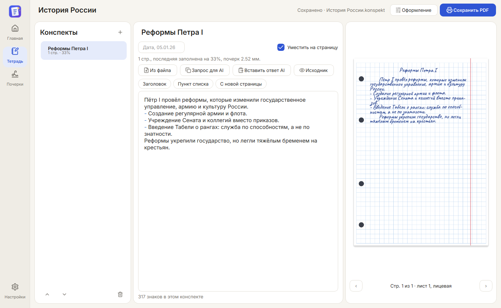
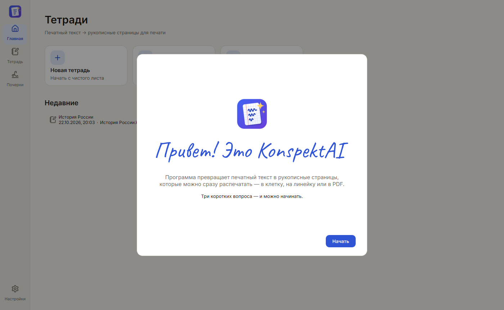
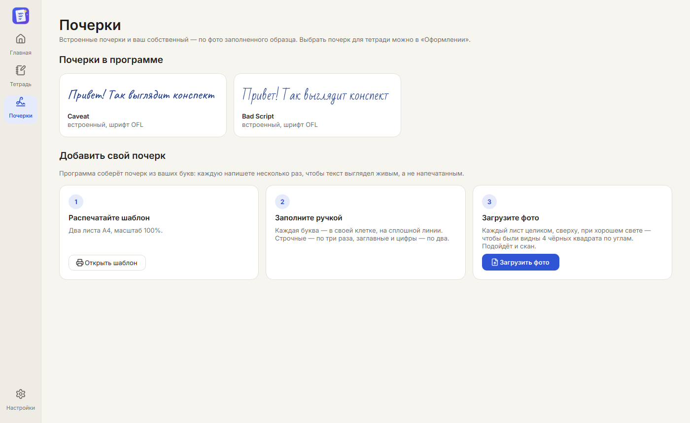

<p align="center"></p>

<h1 align="center">KonspektAI</h1>

<p align="center">Печатный текст → рукописные страницы, которые сразу печатаются в тетрадь.<br>
Бесплатно, без интернета, для Windows.</p>

<p align="center"></p>

## Что умеет

- **Пишет «от руки».** Строки стоят на линиях клетки, буквы каждый раз чуть разные, переносы по правилам.
  Почерки Caveat и Bad Script — или ваш собственный по фото заполненного образца.
- **Печатает прямо в тетрадь.** Блок A5 в клетку с кольцами, обычные A4/A5 (клетку или линейку программа
  печатает сама), лист школьной тетради. Двусторонняя печать вручную: лицевые → переворот → обороты.
- **Подстраивается под ваш принтер.** Мастер калибровки: печатаете лист, фотографируете телефоном —
  программа сама измеряет сдвиг до десятых миллиметра и проверяет результат.
- **Тетрадь из конспектов.** Каждый конспект с новой страницы, «уместить на страницу», даты.
  Режим для службы МЧС: виды подготовки, расписание занятий, планы-конспекты.
- **Берёт текст откуда угодно.** TXT, Word (DOCX), PDF, фото и сканы — русский текст распознаётся офлайн.
- **AI по желанию.** «Сжать через GigaChat» одной кнопкой (бесплатный ключ Сбера для физлиц, хранится
  зашифрованным) или готовый запрос для любого чата.
- Светлая и тёмная тема, установщик, обновления одной кнопкой.

<p align="center">


</p>

## Установка

1. Скачайте `KonspektAI-Setup-1.0.0.exe` со страницы **Releases** справа.
2. Откройте его и нажмите «Установить». Права администратора не нужны, интернет тоже.

Без установки: `KonspektAI-1.0.0-portable.zip` — распакуйте куда угодно (хоть на флешку) и запустите
`KonspektAI.exe`. Всё хранится рядом, в папке «Данные».

Windows может предупредить «неизвестный издатель»: у программы нет платной цифровой подписи.
Нажмите «Подробнее» → «Выполнить в любом случае». Удаление — «Параметры → Приложения → KonspektAI».

## Важно

KonspektAI — инструмент для оформления ваших собственных записей. Если учебное заведение или служба требуют
писать от руки, ответственность за то, как вы используете программу, лежит на вас.

## Для разработчика

```powershell
python -m venv .venv
.\.venv\Scripts\pip install -r requirements-dev.txt
.\.venv\Scripts\python -m stv.main                             # запустить
.\.venv\Scripts\python -m pytest -q                            # тесты
powershell -ExecutionPolicy Bypass -File packaging\build.ps1     # программа + установщик в build\installer
```

Внутреннее имя пакета — `stv` (так проект назывался раньше). Название, версия и адрес обновлений — `stv/brand.py`.

| Путь | Что там |
|---|---|
| `stv/engine/` | Движок: бумага, шрифты, вёрстка, отрисовка, журнал, калибровка, принтеры |
| `stv/app/` | Интерфейс: окно, мастера, редактор, предпросмотр, печать, принтеры, почерки |
| `stv/hands/` | Свой почерк: шаблон, распознавание фото, набор букв |
| `stv/calib_photo.py` | Калибровка принтера по фото листа |
| `packaging/` | Сборка EXE, иконка, установщик, скриншоты, проверка в Windows Sandbox |
| `docs/` | Известные проблемы, скриншоты |

Тетради лежат в «Документы\KonspektAI», настройки, почерки и калибровки — в `%APPDATA%\KonspektAI`.

## Лицензии компонентов

Код KonspektAI — MIT (файл `LICENSE`). Сторонние части: Qt / PySide6 (LGPL-3.0), шрифты Caveat, Bad Script,
Inter (OFL-1.1), иконки Lucide (ISC), модели PP-OCRv5 и RapidOCR (Apache-2.0), onnxruntime (MIT), OpenCV
(Apache-2.0), numpy (BSD), pyphen (LGPL/MPL), python-docx (MIT), pypdfium2 (Apache-2.0/BSD).
Сертификаты НУЦ Минцифры для GigaChat — `assets/certs` (источник и отпечатки в README.txt рядом).
